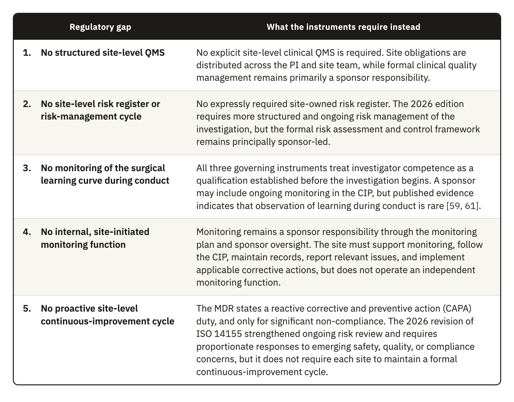
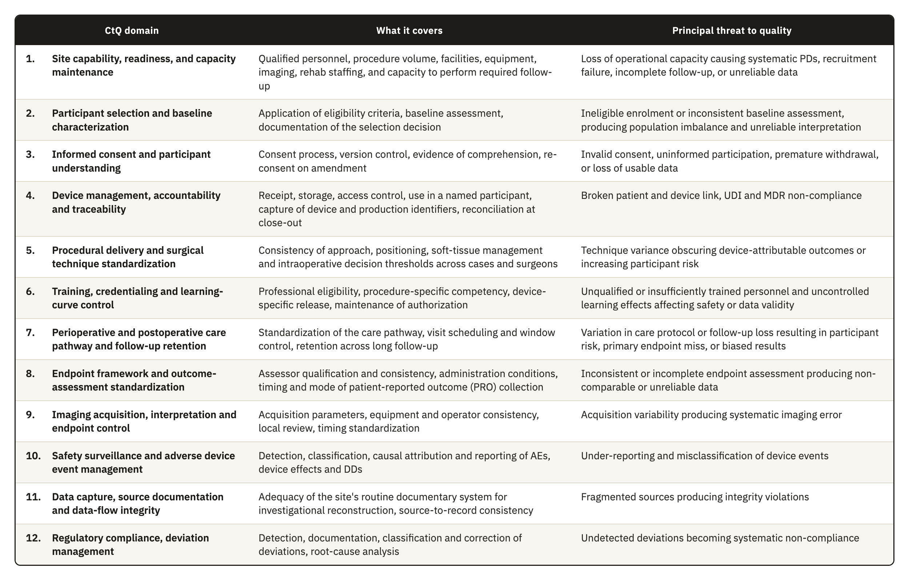
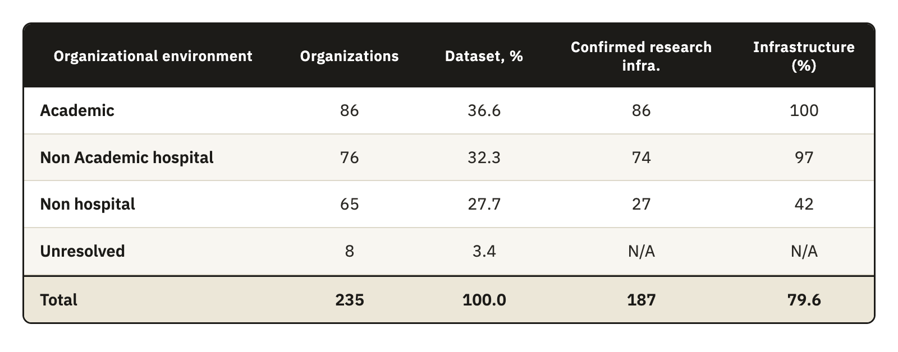
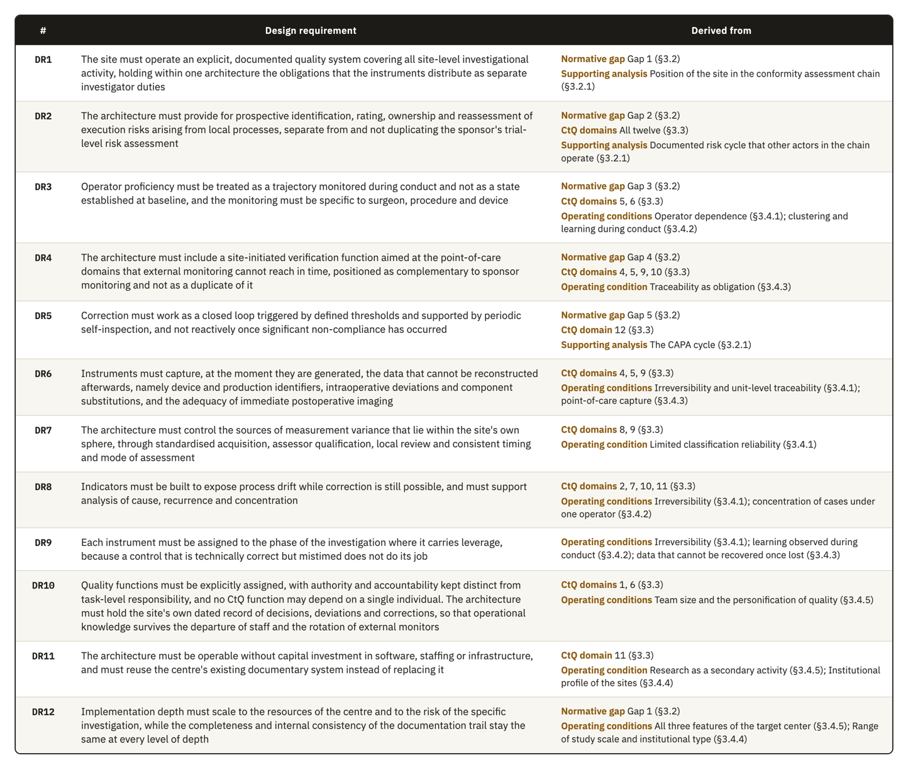

# 3. Identified Gaps and Framework Design Requirements

## 3.1 Scope and analytical basis of this chapter

This chapter reports the analysis that precedes the framework and fixes the limits within which the framework had to be designed. It starts with a clause-level comparison of the three normative instruments that govern shoulder device investigations, ICH E6(R3), ISO 14155:2026, and MDR Annex XV. The comparison works at the level of the individual quality attribute and shows where the instruments agree, where they diverge, and where none of them places a structured obligation on the investigational site.

The attributes are then filtered, grouped, and tested to produce the site-level CtQ domains, which are the operational areas of a surgical center where a local failure would most directly threaten participant safety or data reliability. The operational conditions under which a site-level framework would have to work come next, because they decide what form the framework can realistically take. Section 3.5 brings these analyses together into an explicit set of design requirements. We keep the analysis and the framework in separate chapters so that the derivation stays visible, and the framework can be read as the answer to a problem whose terms were fixed in advance.

## 3.2 The regulatory and operational gap

We compared ICH E6(R3), ISO 14155:2026, and MDR Annex XV clause by clause. The unit of comparison is the individual quality attribute, because that is the level at which a clause creates an obligation. For each attribute we recorded the obligation each instrument creates and the party it binds, together with the clause it comes from, following the procedure in Section 2.2. The comparison sorted the attributes into three categories: strongly harmonized, partly harmonized, and unaddressed at site level.

At system level the instruments agree. The three instruments compared, and ICH E8(R1) as well, place the main quality-management function on the sponsor. ICH E6(R3) assigns the quality system to the sponsor, ICH E8(R1) assigns the identification of CtQ factors to the sponsor and the other parties designing the study, ISO 14155:2026 assigns clinical quality management to the sponsor, and the MDR assigns monitoring to the sponsor [5, 6, 8, 10]. At attribute level, three areas are strongly harmonized: investigator qualification and protocol compliance, source documentation and data integrity, and protocol deviation (PD) documentation. The three instruments treat them in broadly equivalent terms, both in principle and in the obligation they create.

Safety reporting is the only attribute that is partly harmonized. The instruments agree on the principle of prompt reporting, but they differ in who sets the timeline and whom it binds. ISO 14155 sets no fixed reporting deadline for the investigator. It requires reporting to the sponsor without unjustified delay and leaves the operative timeline to the Clinical Investigation Plan (CIP). ICH E6(R3) asks the investigator to report serious adverse events (SAEs) to the sponsor immediately, without a numeric deadline. MDR Annex XV requires the CIP to set the reporting timelines, and Article 80 governs the reporting of the sponsor to the competent authorities [6, 8, 10]. Throughout this comparison, a duty assigned to the investigator is reported as an investigator duty. Even the site-qualification clause makes the principal investigator (PI) responsible for demonstrating that the site has enough eligible participants and a qualified team [8].

The instruments also classify events differently. ISO 14155:2026 separates events related to the investigational device from events related to procedures required by the CIP that fall outside routine clinical practice, and the two are assessed separately [8]. It also establishes central review and classification methods for safety or effectiveness endpoints, including serious adverse device effects (SADEs) and device deficiencies (DDs), when a Clinical Events Committee (CEC) is used [8]. The note to Clause 6.2.3 recognizes that national regulations do not necessarily require the categorization of AEs related to these procedures. ICH E6(R3) has no equivalent category, because it was written for medicinal products and does not treat procedure-related events as a separate class. In the EU, the EN ISO edition of the standard relates its content to the MDR through Annex ZA, and the MDR definitions apply where the standard is used to support conformity. These divergences shape how a site-level instrument has to be built, and Section 4.5.4 constructs the safety indicator accordingly. The result is limited to ICH E6(R3), ICH E8(R1), ISO 14155:2026, and the consolidated MDR text examined in this thesis.

Our narrative search found no peer-reviewed comparison of ICH E6(R3) with ISO 14155:2026. Both texts are recent, so a site that has to draw on both finds little published guidance on how to reconcile them and has to do it informally.

The remaining attributes depend heavily on day-to-day operation at the site, yet the comparison placed them in the third category, where no instrument gives the site a matching obligation. They group into the five gaps in Table 3.1.

**Table 3.1.** The five site-level regulatory gaps identified in the clause-level comparison of ICH E6(R3), ISO 14155:2026, and MDR Annex XV.

The five gaps are not defects in the regulatory texts. They follow from the division of responsibility that the instruments were written to express. ICH E6(R3) and ICH E8(R1) set out the quality system mainly from the point of view of the sponsor. ISO 14155 gives the investigator a set of substantive obligations and writes them as outcomes to be achieved, without describing a system to operate them. MDR Annex XV supplies the enforcement context and the device-specific traceability obligations. None of the three instruments asks the site to build an operational layer that carries these obligations in daily practice.

### 3.2.1 The site's position in the conformity assessment chain

The missing layer becomes clearer once the investigational site is placed in the chain through which a shoulder implant reaches the market. Under the MDR, every device subject to conformity assessment requires a clinical evaluation, whatever its class, although the level of clinical evidence must suit the device and its intended purpose [10]. Article 61 and Annex XIV set out how that evaluation is planned, how data are identified and appraised, and how conclusions are drawn. The results are documented in a clinical evaluation report (CER), which supports the assessment of conformity and forms part of the technical documentation. Shoulder joint replacements are class III devices under Annex VIII, Rule 8, and for implantable and class III devices Article 61(4) generally requires clinical investigations. Article 62(1), Articles 63 to 80, and Annex XV govern how those investigations are planned, approved, conducted, and reported.

Conduct at the site is therefore not a peripheral activity, because the data produced in the operating room and in follow-up become clinical evidence. The clinical evidence becomes the CER, and the report becomes part of the file the notified body decides on. Every link in that chain is therefore only as reliable as the one before it.

ISO 14155:2026 does not create a site-level quality-management system. It places clinical quality management in Clause 9, Responsibilities of the sponsor, which opens with Clause 9.1, Clinical quality management, and requires the sponsor to maintain written clinical quality procedures and compliance records [8]. Clause 10, Responsibilities of the PI, has no equivalent quality-management subclause. It covers the general responsibility of the investigator, the qualification of the investigator and the investigation site, communication with the ethics committee, informed consent, compliance with the CIP, medical care, and safety reporting [8]. Clause 10.3 places on the PI the duty to demonstrate that the proposed site has enough eligible participants and a qualified team, and Clause 10.6 asks the PI to keep an adequate team throughout the investigation. These are qualification and staffing duties, and they do not describe a local quality-management system.

The fourth edition widened that asymmetry. It added a provision on the CEC, strengthened the Data Monitoring Committee requirement, and added the risks arising from the processes of the clinical investigation [8]. Each of these mechanisms is led by the sponsor and works centrally, and none has a counterpart in Clause 10. The sponsor side of the system therefore expanded without an equivalent local structure being assigned to the PI. None of the standards examined here describes a quality system for the investigational site in the way that ISO 13485 does for a manufacturer and ISO 15189 does for a medical laboratory.

Reading across ISO 13485:2016, ISO 14971:2019, and ISO 14155:2026 allowed us to group the mapped requirements into four functions [8, 52, 53]. They are a defined structure of authority and competence, a documented risk cycle, controls over execution and records, and a loop that measures performance and corrects it through corrective and preventive action (CAPA). The standards do not state these four functions as a shared taxonomy. They are the synthesis adopted in this thesis, and Chapter 4 uses them as the four pillars of the framework.

A documentary search of the three governing instruments also showed one boundary. The terms “proficiency,” “operator performance,” “credential,” “proctor,” and “surgical skill” did not occur in ISO 14155:2026, ICH E6(R3), or the MDR. “Learning curve” occurred once, in ISO 14155:2026 Annex A, where it appears as a CIP item on roll-in procedures, and the term “training” occurred 29 times in ISO 14155:2026. Within this corpus, the learning curve is therefore a design consideration for the CIP, and no instrument assigns the site the case-by-case observation of each operator's proficiency during conduct.

## 3.3 Site-level Critical-to-Quality domains

The comparison left us with a classified set of attributes, which three further steps turned into domains: a filter, a grouping by operational area, and a test against the four criteria drawn from ICH E8(R1) in Section 2.2.2. Neither ICH E8(R1) nor ICH E6(R3) performs this translation, which identifies the CtQ factors that matter at site level, as distinct from the trial-level factors a sponsor defines.

A trial-level analysis asks which design features of the study are critical to the interpretability of its results. A site-level analysis asks which operational features of a particular center would compromise participant safety or data reliability in the cases that center contributes. Device-specific guidance on CtQ factors exists and is useful, but it is written from the trial-level perspective [34, 55].

The process produced the twelve domains in Table 3.2, each described by what it covers and by the principal threat that arises when control is inadequate. Figure 4.4 later shows which instruments of the framework control each domain.

Several of these domains take a different operational form in device investigations. Device management and traceability require accountability from receipt through use in a named participant to eventual return or explantation [8, 10]. Procedural delivery and learning-curve control deal with surgeon-dependent variability, which the methodological literature has treated as a design problem and which these domains treat as a site-level control problem. Imaging control recognizes that imaging can determine eligibility, provide an endpoint, and supply safety data. The supporting literature is general or based on knee trials, so it supports these functions of imaging without establishing how often they occur in shoulder investigations [56, 57]. Variability in how images are acquired can therefore produce systematic error that cannot be told apart from genuine clinical variance.

The domains govern the framework in two ways. Every component is introduced to control the risks of one or more domains, and every performance indicator is anchored in at least one domain.

## 3.4 Operational conditions constraining the design

The gaps establish what is missing and the domains establish what has to be controlled, but the form a site-level framework can take depends on the conditions under which it would have to work. Six conditions apply. Five are structural and common to surgical device investigations, and Section 3.4.1 sets out the consequence of each. Two of the five, operator dependence and unit-level traceability, constrain the design strongly enough to receive their own sections. The sixth is the institutional setting where these investigations take place, which the registry analysis described and which Sections 3.4.4 and 3.4.5 report.

**Table 3.2.** The twelve site-level CtQ domains derived in Section 2.2.2, with the scope of each domain and the principal threat to quality that follows from inadequate control.

### 3.4.1 Design consequences of the five structural conditions

Section 1.3 introduced five conditions that separate surgical device investigations from the pharmacological model, and each one has a direct consequence for how quality can be managed at the site.

1\. Irreversibility. A drug can be stopped, reduced, or replaced if it fails or causes harm, while a prosthesis fixed to bone has produced a permanent change in the anatomy of the participant. This raises the cost of every quality failure that happens at surgery. An incorrect implant size, an undocumented technical deviation, or a missing traceability record cannot be put right afterward in the way a transcription error can. The European Medicines Agency (EMA) has described poor risk identification and mitigation as leading to a reactive approach based mainly on corrective action [1]. ICH E8(R1) therefore calls for resources to identify and prevent or control the errors that matter (Section 3.3.2), and the CTTI CtQ principles also place attention on prevention before conduct [55]. A site-level framework therefore has to identify in advance which steps of the surgical pathway are irreversible and put preventive controls on them.

2\. Operator dependence. Results depend on the device and also on the person who implants it and the technique used [19, 58]. Requirements for surgeon qualification and for training with the specific device already exist. Other sources of variation also need control, including learning-curve effects, differences among surgeons in positioning and soft-tissue management, and intraoperative judgment. Blencowe et al. [59] provide a direct precedent, since they showed that standards for the delivery of a surgical intervention can be agreed before a trial and monitored during conduct through forms that capture deviations. Quality management has to characterize this variation, because removing it would mean removing surgical judgment itself. The framework therefore needs the operator as a unit of analysis, alongside the participant and the case.

3\. Unit-level traceability. Pharmaceutical and device trials both require records linking batch or serial numbers to participants [6, 8]. The difference lies in duration. A medicinal product is used or returned, whereas an implanted device may remain in the participant for years, and its records must also cover return or explantation, including traceability after the investigation ends [8, 10]. In surgery, traceability also extends to reconstructing the surgical decisions that produced a given configuration in a given participant, which adds a documentary burden of a different order.

4\. Follow-up burden. Long follow-up is not unique to surgical trials, but the measurements involved are. ROM and radiographic assessment of implant position require the participant to attend in person, and PROMs require consistent collection at the specified time points. Consistent assessment procedures and independent central review, where appropriate, are methodological responses to interobserver variability, but none of the three instruments compared requires the same assessor at every visit [25, 60]. Imaging standardization also requires compatible acquisition procedures and quality control (QC) [56, 61]. These requirements raise the cost of every visit and increase the risk of attrition over the years between surgery and the late assessments. Orthopedic studies with at least three years of follow-up reported 14.8% loss to follow-up, compared with 9.8% in studies with shorter follow-up [23], and one shoulder arthroplasty cohort reported 34.3% loss by the seventh year [24].

5\. Measurement reliability. Shoulder investigations rely on radiological and clinical classifications that often show only fair to moderate interobserver reliability [62]. Widely used classifications of proximal humeral fractures have been reported with interobserver kappa coefficients in the fair range, even when three-dimensional models reconstructed from computed tomography data are used [63]. Two assessors looking at the same patient can therefore reach different conclusions about eligibility or about an outcome, and the database cannot separate that variance from genuine clinical variance. Outcome measurement adds to the problem, because shoulder arthroplasty trials vary widely in their outcome domains, instruments, and assessment time points, enough to motivate core outcome sets for shoulder disorders [64, 65, 66].

### 3.4.2 Operator-dependent variability as a design constraint

When one surgeon operates on several participants, those participants share the technique, the intraoperative decision thresholds, and the perioperative management of that surgeon, so they are not independent of one another. This effect is known as clustering [67]. A problem in the execution of one surgeon therefore affects every case that surgeon contributes. Clustering also affects trial design and analysis. Ignoring nonnegligible clustering produced type I error rates above 20% in simulations [68], while only 21.5% of eligible orthopedic randomized trials involving several centers or treatment providers used an analysis that accounted for it [69].

The methodology literature on surgical trials recognizes clustering as one of their central challenges, together with the learning curve that interacts with it [67, 70]. Practice remains uneven. A survey of 44 Clinical Trials Units in the United Kingdom found that clustering was managed mainly by stratification at design, which balances the cases of each surgeon across the arms of the trial, and by adjustment at analysis. Eighty-nine percent of the units managed learning by setting a minimum level of expertise for the treatment provider, and only one unit reported analyzing learning effects as part of the main analysis [71].

Operator learning is therefore controlled mainly at entry and is rarely analyzed or reported during conduct. In a review of 247 published surgical trials, 39% addressed expertise through predefined surgeon credentials, while only one trial analyzed learning during conduct [72]. The documentary search in Section 3.2.1 reached the same boundary, since the governing instruments address qualification and training and do not assign the site any ongoing observation of operator learning. A protocol can define a procedure in general terms, but it cannot standardize the many small decisions through which a particular surgeon implants a particular device in a particular anatomy. The interval between entry qualification and performance during conduct is where a site-level instrument can work, and Table 3.1 records it as gap 3.

### 3.4.3 Traceability as a point-of-care obligation

Unit-level traceability is detailed in content and demanding in its circumstances, because it is carried out in the operating room, under time pressure, by staff whose attention is on the surgical procedure. ISO 14155:2026 requires records of receipt, identification, quantity, dates of use, participant identification, and return or explantation, together with written procedures for the whole accountability process [8]. The sponsor keeps the record of physical location up to delivery to the site, and the records of the investigator continue the link through use in the participant and any return or explantation. The MDR also requires access control, return procedures, and follow-up in the CIP, the immediate identification and recall of devices in an emergency, and traceability after the investigation [10]. Because dates of use and participant identification have to be recorded, capture at the point of care is the most reliable operational response in surgery. A break in the chain can compromise regulatory compliance and the attribution of an AE to a specific device or lot, although the cited clauses do not state that such a break invalidates the affected case.

Traceability is the clearest example of a pattern that runs through the domains in Table 3.2. A class of critical data is generated at the point of care, where external oversight cannot see it as it happens, and it cannot be recovered once lost. The intraoperative decision to substitute a component belongs to this class, and so does the technical deviation prompted by unexpected anatomy. The immediate postoperative image that may or may not be adequate is another example, together with the early complication whose relationship to the device is still undetermined. A framework that deals with this class of data therefore has to work at the moment the data are generated.

### 3.4.4 Where these investigations are conducted

The registry search described in Section 2.4 produced 46 eligible industry-sponsored investigations of implantable shoulder devices. Repeated facility listings were cleaned and resolved at organization level, which gave 235 organization-level entries. Each organization counted once in the distribution, and every associated ClinicalTrials.gov identifier stayed linked to its record. Eight entries could not be resolved to a verifiable clinical organization. Section 2.4.2 describes the normalization, the evidence sources, and the case-by-case review behind these decisions.

Table 3.3 reports the organizational environment in four mutually exclusive categories. We chose this variable because academic status and institutional ownership could be identified consistently from public institutional descriptions. We also recorded, for each environment, how many organizations publicly presented a permanent clinical trial infrastructure, as a more direct indication of established research support. Neither variable measures trial quality or research performance.

**Table 3.3.** The organizational environment of the 235 organizations in the registry dataset, with the number and share holding publicly identifiable permanent clinical trial infrastructure by environment type.

Note. Dataset percentages use all 235 organization-level entries, while percentages with infrastructure use the total within each environment and are rounded to the nearest whole percent. The total percentage includes the eight unresolved entries in its denominator. An infrastructure classification of no means that the public sources consulted did not establish a permanent structure. Research activity may still take place through temporary staff or sponsor-provided support.

Academic organizations and nonacademic hospitals accounted for 162 of the 235 entries (68.9%), and permanent clinical trial infrastructure was publicly identifiable in 187 organizations (79.6%). Most organizations in this sample therefore worked within hospital settings or publicly presented an established research structure.

The nonhospital environment contained 65 organizations, 27.7% of the dataset. A permanent clinical trial infrastructure was publicly identifiable in 27 of them and not in the other 38, which represent 58.5% of the nonhospital group and 16.2% of the full dataset. They form a relevant part of the sample for which permanent research support could not be established from public information.

The sample was concentrated in the United States, which accounted for 149 organizations against 86 elsewhere, and 60 of the 65 nonhospital organizations (92.3%) were in the United States. The registry findings describe the selected sample and cannot establish how common comparable organizations are in Europe or across all shoulder device investigation sites. The framework itself was designed under the European regulatory context, the MDR and ISO 14155, because the thesis was developed in the EU and the supervising team has its regulatory experience there. The registry sample is dominated by the United States because ClinicalTrials.gov offered more data and better tools for this analysis than the European sources available to us, and the study is not focused on the United States. We therefore use the registry only to describe the organizational profile of the sites, while the obligations the framework answers come from the European instruments and the ICH guidelines.

### 3.4.5 The operating conditions of the target center

The target center of the framework is a private organization that takes part in device investigations on a recurrent basis and has staff who carry research tasks, but whose main activity is surgical care. Research is a regular but secondary activity in such a center, and the center has no system dedicated to the quality of its investigations. Section 4.7.1 calls this context Type B. Smaller centers that take part in investigations only occasionally face the same conditions with even fewer people, and Section 4.7.1 calls them Type C.

The registry supports this choice in part. Nonhospital organizations formed more than a quarter of the sample, and for 38 of them the public sources did not identify a permanent clinical trial structure (Section 3.4.4). The framework therefore could not assume that a participating organization has a dedicated clinical trial office or a research quality function, even when it takes part in industry-sponsored investigations. The registry did not measure how often an organization takes part in investigations, how many staff it assigns to research, or what priority research receives, so the features that define the target center are design assumptions that require assessment during implementation. A missing public record of permanent structure also does not show an absence of research activity or poorer trial conduct, because internal arrangements may not appear on public pages and temporary or sponsor-provided support may be available.

The first feature of the target center that shaped the design is that research is a secondary activity, run by people whose main responsibilities are clinical. The instruments therefore had to fit within existing roles and existing records, without depending on new infrastructure or a dedicated quality department. The team is also small, and knowledge of how quality is kept tends to sit with a few named people, so key quality decisions had to remain in records held by the organization when individual responsibilities change, and each critical function needed a named substitute. Finally, the center has no dedicated system for investigation quality, so the instruments had to work on paper or within an electronic system the center already uses.

These conditions define the full implementation that Section 4.7 describes for Type B, and the essential core for Type C follows from the same conditions with fewer people. Organizations with established research departments, Type A, can place the same functions within their existing systems and use deeper controls. The registry findings support an adaptable design for a relevant part of the sample, but they do not show that the framework can equalize performance across environments, which would need empirical evaluation.

## 3.5 Design requirements

The CtQ domains define what matters, but they do not say what the site must have in place for a domain to be under control. The design requirements fill that space. Each one turns an area of criticality into a statement of what an acceptable solution has to deliver, written so that a component of the framework can later be checked against it, and together they complete the second DSRM activity, the definition of the objectives for a solution.

The three analyses in this chapter produced twelve requirements, which Table 3.4 states and traces to their origin. Requirements DR1 to DR5 follow from the regulatory gaps, DR6 to DR9 from the CtQ analysis and the structural conditions of surgical investigation, and DR10 to DR12 from the operating conditions of the target center. Requirements and domains are not in one-to-one correspondence. All twelve domains feed DR2, because the site risk register has to cover each of them, and several domains also feed more specific requirements where they leave an obligation without an operational means, as Table 3.4 shows.

Meeting one requirement can make another harder to meet, a property that Table 3.4 does not show. DR11 limits how DR1 to DR9 can be met. A site could satisfy every functional requirement by building a dedicated information system for the investigation, a solution that would pass the regulatory analysis and fail the operational one. When two requirements point to different solutions, we treat the operational constraint as the binding one, because a control that the site does not execute gives no protection.

The requirements are traceable to the analysis in this chapter, and each component of the framework answers at least one of them. This trace shows that the framework is coherent with the evidence it was built from. It does not show that a site needs the framework, a question Section 5.1 takes up.

**Table 3.4.** The twelve design requirements for the site-level quality framework, with the regulatory gap, CtQ domain, or operating condition from Chapter 3 that each one is derived from.
