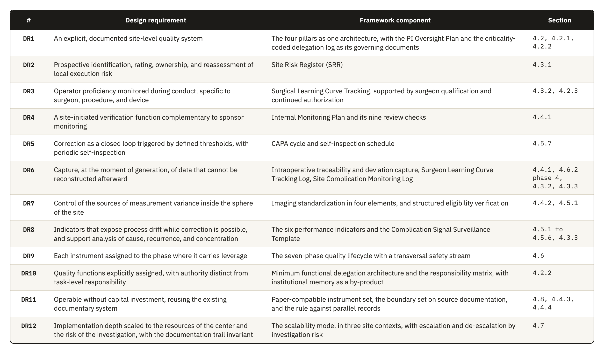
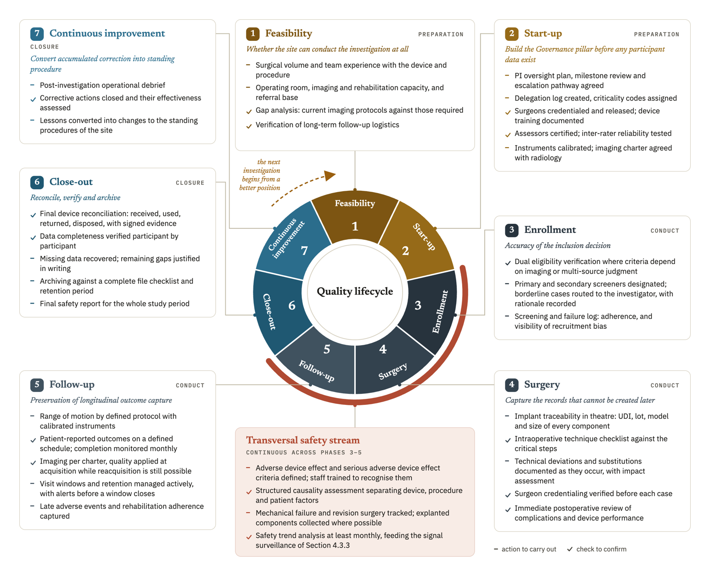
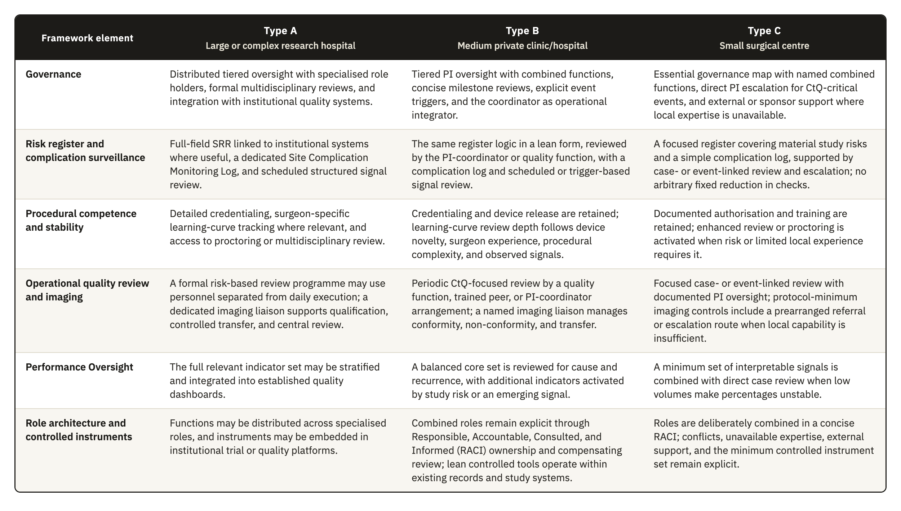
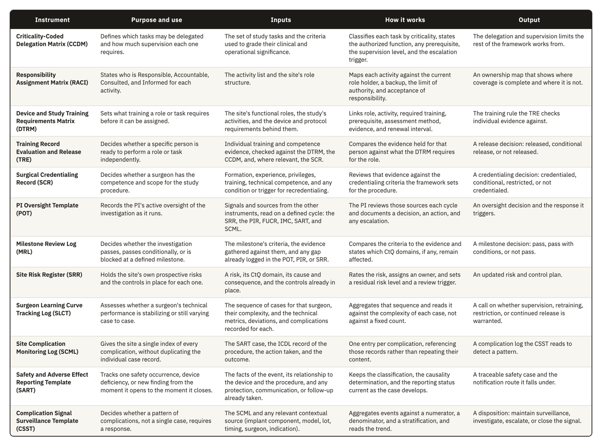
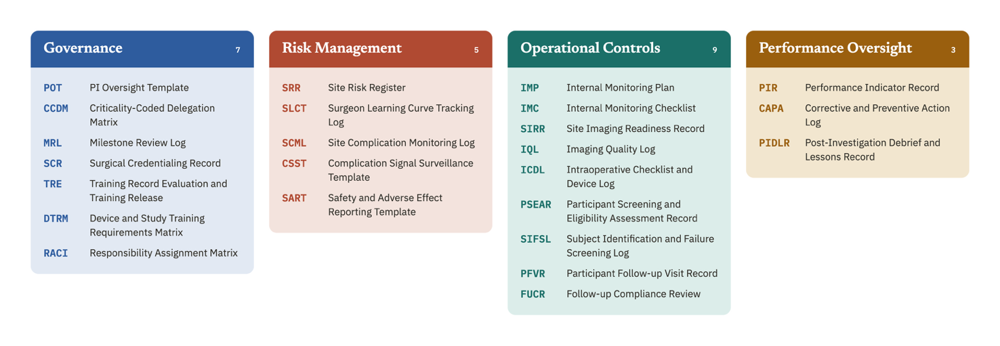
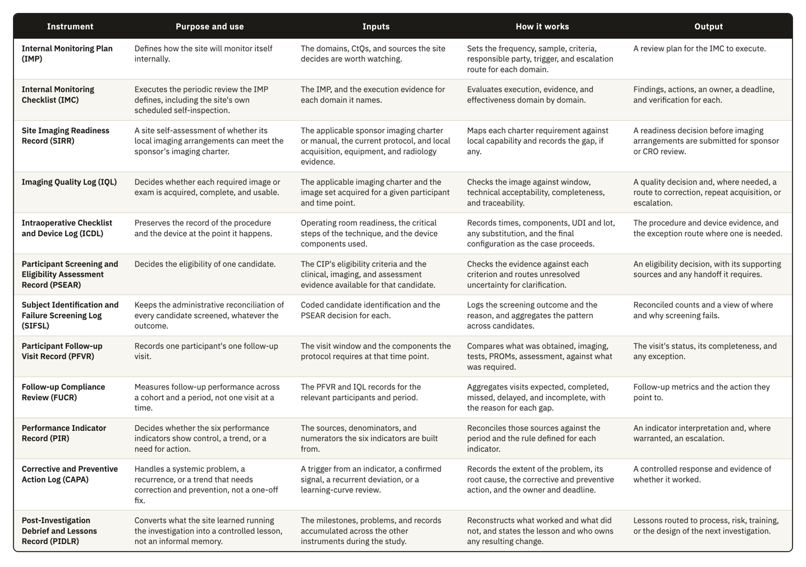
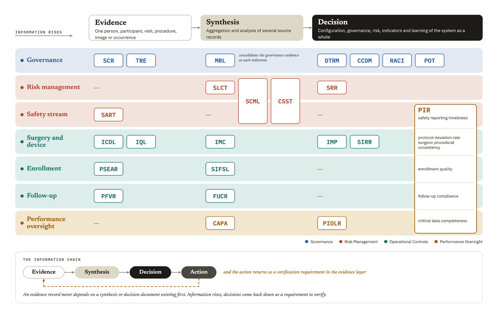
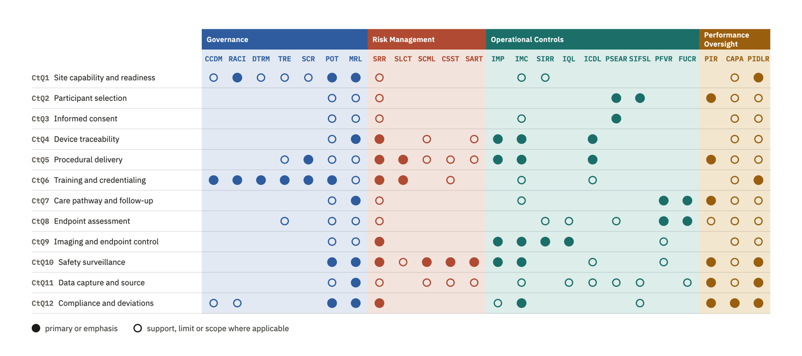
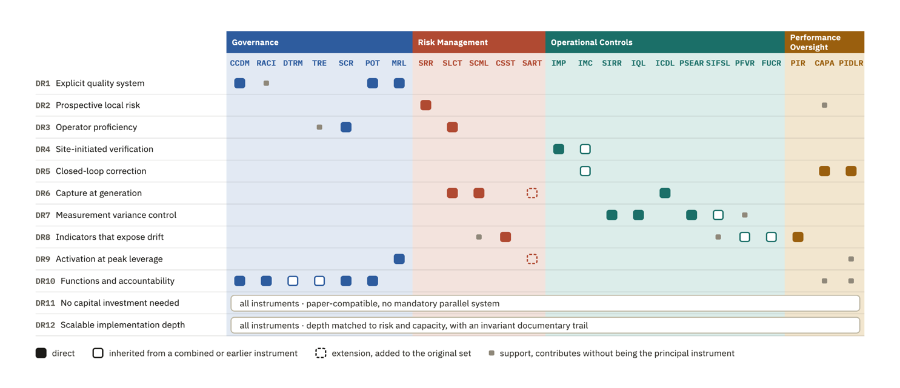

# 4. Results: The Quality Framework

## 4.1 Overview and design rationale

Chapter 3 closed the second activity of the DSRM, which is the definition of the objectives for a solution, and started the third by designing the requirements DR1 to DR12. This chapter carries out the second part of the third activity, which is the development of the model that meets those requirements. It describes each component in enough detail for a site to operate it.

The model is called the Site-Centered Operational Quality Management Framework. It has four pillars, and each pillar holds a set of instruments. Three further elements govern how those instruments are used. A lifecycle determines when each instrument is activated, a role architecture determines who operates it, and a scalability model determines how deeply it is implemented based on the structure and capacity of the site.

The four pillars are Governance, Risk Management, Operational Controls, and Performance Oversight. They are the framework's synthesis, not a taxonomy reproduced from one standard. They map recurring functions across ISO 13485:2016, ISO 14971:2019, ISO 14155:2026, and ICH guidance. Governance appears in ISO 13485 Clause 5, ISO 14971 Clause 4, and ISO 14155 Clause 9.1. Risk management appears in ISO 13485 Clause 7.1, ISO 14971 Clauses 5 to 7, and ISO 14155 Clauses 6.2.1 to 6.2.4. Operational controls appear in ISO 13485 Clauses 7 and 7.5 and ISO 14155 Clause 7, while performance oversight appears in ISO 13485 Clauses 8, 8.2.4, 8.4, and 8.5, ISO 14971 Clauses 9 and 10, and ISO 14155 Clause 9.1. Using functions already recognizable in the device quality system makes the architecture easier to interpret and implement.

Table 4.1 maps the twelve design requirements to the components that answer them, and every section of this chapter returns to that mapping.

This framework was designed with its main focus on the vulnerability discussed at Section 3.4.4. That setting shaped the operational constraints reported in Section 3.4.5, and it explains the form the instruments take. The framework is nonetheless written to be transversal. Nothing in its architecture depends on a single form of organization, and the components are described as functions, so that a center with a different staffing structure can map its own posts onto them.

**Table 4.1.** The twelve design requirements from Section 3.5, the framework component that answers each one, and the section of Chapter 4 where that component is developed.

## 4.2 Pillar 1: Governance

Governance defines the local authority structure through which regulatory accountability is exercised at site level. The quality of the investigation depends on surgeon-dependent technical execution, on intraoperative decision variability, on device traceability, and on the reproducibility of postoperative assessment. The pillar is therefore designed so that clinical authority, delegated execution, procedural competence, and device-specific training are each controlled in a documented and risk-proportionate way.

The regulatory basis sits in two places. ICH E6(R3) expects investigator oversight to be proportionate to the nature of the delegated activities, to the importance of the data collected, and to the risks to participant safety and data reliability. ISO 14155:2026 keeps responsibility for the investigation with the PI under Clause 10.1, even when activities are delegated. It also requires the qualification of the investigator under Clause 10.2 and of the site under Clause 10.3.

This pillar has four components, which are the oversight model, the delegation structure with its role architecture, surgical qualification, and device training documentation. The oversight model defines how authority is exercised, and the other three define the conditions under which its influence is clear. The pillars that follow observe what the holder does afterward, which is why the surgical learning curve is treated in Section 4.3 while the qualification decision it is treated here.

### 4.2.1 The oversight model

During the design process, we developed three analytic alternatives for allocating oversight at site level. They are not an empirically established taxonomy. They represent recurrent ways in which site functions may be distributed under different constraints of staffing, capacity, and existing organization. Published descriptions of trial-site operations confirm that these functions must be covered, but do not divide them into the same three models. We therefore present the alternatives as design choices, compare their advantages and limits, and explain why the framework adopts the third.

The first is a strongly investigator-centered model, where the PI intervenes directly in most critical activities and personally reviews most documentary and operational workflows. It looks like the safest option because it conveys an impression of intensive supervision. However, it becomes difficult to sustain as activity expands. Site PIs already carry scientific, regulatory, recruitment, supervisory, and administrative duties, and their contribution is often under-recognized [72]. In this model, administrative review can consume attention needed for the areas where clinical intervention is genuinely irreplaceable, such as confirming surgical appropriateness, interpreting intraoperative deviations, assessing whether a complication is related to the investigational device, or reading early signs of executional drift as a coherent clinical picture. It also scales poorly across the operating room, radiology, postoperative functional follow-up, implant accountability, AE management, and data QC.

The second is a coordinator-led model, where daily management is delegated to the study coordinator while the investigator retains final authority. This is operationally plausible because the clinical research coordinator is a core site function [73], and ICH E6(R3) expressly permits delegation while retaining ultimate investigator responsibility and proportionate oversight [6]. Food and Drug Administration (FDA) supervisory guidance also emphasizes appropriate delegation, staff qualification, and investigator oversight [74]. Its weakness is not coordinator leadership itself. The risk is nominal oversight when there is no defined review structure, established periodicity, formal escalation pathway, or explicit statement of what requires direct investigator involvement. In surgical investigations, those points include borderline eligibility decisions, unplanned intraoperative changes, component substitutions, revision-related interpretation, and inconsistencies whose significance is not apparent from the documentation alone.

The framework adopts a third arrangement, a tiered and risk-adjusted model of PI oversight. Investigator involvement is stratified by task criticality and calibrated to the risk each task poses to participant safety, procedural integrity, device accountability, and data reliability. The advantage of this model is that it rejects the idea that effective oversight comes from universal visibility or indiscriminate sign-off. Oversight is concentrated on the processes, decisions, and data flows that can affect participant protection and study validity, which applies the CtQ logic of ICH E8(R1) to the allocation of the investigator's own attention. Involvement is intensified where clinical judgment, procedural authority, and regulatory accountability converge, and five mechanisms turn this principle into operable controls.

Turning that principle into a workable schedule is harder than it sounds. A site has to decide, in advance and for each type of activity, what genuinely requires the investigator's own judgment and what can be reviewed after the fact without loss, and that line moves with the device, the procedure, and the experience of the team performing it. Set the threshold too low and the investigator reverts to the first model this section rejected; set it too high and oversight becomes a formality that produces no real review at all.

Grading delegated activity by stakes carries its own difficulty, because criticality is not intrinsic to a task in the abstract. Coordinating a routine visit is administrative until a scheduling choice places a follow-up outside the protocol window, and recording an intraoperative note is clerical until the note is what later reconstructs a disputed complication. A grading scheme has to anticipate which routine activities carry that kind of latent significance, and a scheme copied wholesale from another site's practice will miss the ones specific to this investigation and this team.

Choosing where to place formal review points is itself a judgment call with real consequences. Reviewing too early misses problems that only surface once a procedure or a follow-up window has actually occurred; reviewing too late lets a correctable pattern continue through several more cases before anyone with authority sees it. The points that matter most, procedural implementation, the immediate postoperative period, the approach to endpoint assessment, and close-out, are where the most consequential threats to integrity concentrate, which is itself a claim about the risk profile of this investigation and would not transfer unchanged to a different device or procedure.

An event-triggered escalation pathway requires investigator notification regardless of the routine review cadence, because scheduled review cannot capture every critical governance moment in a high-variability surgical study: some events threaten participant safety or causal interpretability immediately and have to reach investigator authority before the next scheduled point.

An oversight meeting architecture embeds this review in the recurring rhythm of the site, so it does not depend on ad hoc contact. This is a design transposition from ISO 14155:2026's use of structured, consensus-based review at sponsor level under Clause 6.12 and from the EMA reflection paper's recommendation of multidisciplinary review for risk assessment [1], not evidence that site-level forums have independently been shown to improve oversight. Sustaining it is harder at the small or mid-sized centers this framework targets, where the same few people who attend the meeting are also the ones who would otherwise be doing the clinical and administrative work the meeting exists to review.

These five mechanisms together answer DR1 at the level of authority. They also carry part of DR10, because an oversight model that is written down, scheduled and evidenced produces a record that survives the departure of the people who operated it.

### 4.2.2 Delegation, roles, and functions

The delegation structure makes the oversight model operable. Without designated functions, authorized personnel, training-linked release, and controlled interfaces between roles, even a well-designed oversight model is organizationally underpowered. The relationship runs in both directions, since a strong delegation structure reduces ambiguity, makes escalation thresholds meaningful, and lets the investigator concentrate attention where judgment is clinically necessary.

ICH E6(R3) allows the investigator to delegate trial-related activities while retaining ultimate responsibility. It requires oversight of delegated persons proportionate to the nature of the activity, the importance of the data, and the risks involved. It also requires that delegated personnel be appropriately qualified and adequately informed about the protocol and the investigational product. ISO 14155:2026 governs additional members of the investigation site team under Clause 7.6, which requires documented training before assignments begin, together with a record of names, initials, signatures, functions, and designated authorizations.

The conventional delegation log is principally a record of who performs which trial-related activity. ICH E6(R3) Section 2.3.3 requires documentation proportionate to the significance of the activity, but does not require a criticality code or evidence of competence to be embedded in the same record. Delegation records are nevertheless subject to direct inspection scrutiny, and the investigator remains accountable for delegated work [74, 75]. In this framework, the delegation structure therefore has four additional properties. It is task-based, competency-gated, version-controlled, and linked to the review intensity defined by the oversight model.

The task-based property matters most, because a research nurse may be entirely appropriate for coordinating visits, maintaining screening logs, and managing routine query traffic, and still not be the right person to resolve a clinically meaningful discrepancy in operative documentation.

The framework therefore defines a minimum functional architecture that reflects how orthopedic implant investigations are run, and it names six functions.

**The PI** is accountable for conduct at the site and for the appropriateness of every delegated activity. Delegation transfers execution, and responsibility stays with the investigator.

**The study coordinator,** or the research nurse where the site uses that title, is the principal operational integrator. The function coordinates consent logistics and study visits, and it carries documentation flow and issue escalation across the site. Its limit is clinical. A coordinator does not decide eligibility and does not interpret safety information, and classifying a PD sits outside the function as well.

**Operating room staff** prepare the investigational device for use and apply the chain-of-custody controls. They record the intraoperative procedural data and complete the procedural source records. The function documents procedural facts and holds no authority over clinical decisions.

**The radiology liaison** supports adherence to the imaging protocol and compliance with the imaging windows, and it holds the technical consistency of image acquisition and transfer. Control stops at technical quality. Where central reading applies, endpoint adjudication is not a site-level function.

**The functional assessor,** in many sites a physiotherapist, conducts ROM measurement and the PRO workflows wherever those activities are critical to endpoint quality. The function administers assessments by a defined method and does not interpret what an endpoint means.

**The data QA** function manages query flow and monitors critical-data completeness, and it keeps pending data risks visible. It identifies discrepancies. A discrepancy that is clinically meaningful goes to the PI for resolution.

These are general functions, not required positions. In a small or mid-sized center, one individual may hold more than one of them. The framework therefore requires each function to be assigned to a named individual and formally documented, whatever the number of people involved, so the site can identify who is responsible and has no need to assume that the function is covered.

### 4.2.3 Surgeon qualification and continued authorization

The sponsor and the site share responsibility for controlling which surgeons may perform study procedures throughout the investigation. The sponsor normally defines the minimum entry criteria through the CIP, training requirements, and the study risk assessment. During site qualification, the sponsor reviews the available evidence and confirms whether the site meets these predefined criteria. The site applies the criteria to its surgical team and demonstrates that each delegated surgeon satisfies the applicable requirements.

ISO 14155:2026 clarifies this division of responsibility across the sponsor, the PI, and the investigation site. Clause 6.8 requires the sponsor to define site selection criteria and verify the PI's qualifications and site adequacy. Clause 9.2.1 also requires the sponsor to ensure verification and documentation of relevant training, experience, and knowledge. Clauses 10.1 and 10.3 require the PI to ensure team qualification, training, documentation, and oversight. The PI must demonstrate that team members have suitable education, training, and experience for their assigned responsibilities. Clause 10.6 further requires the PI to maintain and document an adequate investigation site team throughout the investigation. Together, these provisions establish sponsor verification and site responsibility for demonstrating and maintaining team qualification.

The framework reflects this allocation and defines the site contribution through application, documentation, and continued oversight. Sponsor requirements establish the threshold, and the site converts that threshold into documented decisions for each surgeon. The site also links each decision to the delegation log so assigned surgical tasks remain consistent with current authorization.

Building that evidence is harder than confirming a specialty credential on file. A surgeon's general standing, procedure-specific competency, and readiness on this particular device are three different questions, and a good answer to one does not answer the others. Standing can be adequate for a comparable procedure and still uncertain for this device's specific technique, and the site has to decide how much of that uncertainty sponsor-set entry criteria already resolve and how much is left for its own judgment to close before the first case.

The site may also apply temporary controls when the risk assessment or expected learning curve supports additional supervision. Such controls may include proctoring, co-surgery, or initial assignment to cases with lower procedural complexity. Their use remains proportionate to the procedure, the device, the surgeon's experience, and the requirements established for the investigation.

The framework also treats qualification as a status that remains current throughout the investigation, not a decision made once and left standing. It requires re-evaluation annually and after protocol amendments, safety signals, complication clusters, or evidence of performance drift. The harder question is what counts as evidence of drift early enough to act on, since a surgeon's own performance is the most direct signal available and also the hardest to read without a longer run of cases to compare it against. The site can then confirm, restrict, suspend, or restore surgical authorization according to the available evidence. This maintenance function represents a distinct site-level contribution because it connects observed performance with continued authorization to operate.

### 4.2.4 Device training documentation

Device training documentation is the controlled body of records showing that site personnel received the training their activities require, covering the protocol, the instructions for use (IFU), and the responsibilities assigned to each person. Its function in this framework is operational as well as evidentiary. Through it the site shows that critical activities were performed by personnel who were delegated and also prepared for the specific investigational context.

The requirement is grounded in both bodies of guidance. ICH E6(R3) requires that individuals involved in the trial be qualified by education, training, and experience, and that those assisting receive trial-related training corresponding to their delegated activities. ICH E8(R1) requires that study personnel be trained commensurately with their role before becoming involved, with retraining as needed during conduct. ISO 14155:2026 requires documented training before assignments begin under Clause 7.6. The fourth edition also strengthened the upstream side of this obligation, since Annex B now requires the sponsor to include information on device use training in the Investigator's Brochure under item B.2 h). The sponsor therefore has to document what training exists, and no clause requires the site to verify that the resulting competence is maintained, which is the space this component occupies.

In orthopedic device investigations, training has to cover device-specific functions. These include proper use of the investigational device and instrumentation, the operative workflow, device accountability, safety-reporting interfaces, and site processes affecting a CtQ factor. MDR Annex XV, Chapter I, Section 2.7 requires the sponsor to verify, arrange where necessary, and document training in proper device use, the CIP, and GCP. Annex XV, Chapter II, Section 3.2 also links investigator suitability to device and procedural training and experience. ISO 14155:2026 Annex B.2 includes training information in the Investigator's Brochure, and Clause 7.9 requires device-accountability procedures. Medicinal-product GCP also requires qualified personnel and investigator familiarity with the investigational product [6], so the framework does not claim that the device burden is categorically wider. It specifies the additional device-linked functions that must be controlled. Training documentation is therefore role-specific and version-controlled, identifies who was trained, on what, when, by whom, and under which controlled document version, and records when the person was authorized to work independently.

Five training domains are distinguished in a shoulder investigation.

> 1\. Protocol and procedural training covers study objectives, key eligibility restrictions, endpoint-relevant visit windows, PDs, and study-specific decision points.
>
> 2\. Device-specific training covers the investigational system, the instrumentation, the implant components, preparation steps, handling requirements, and any workflow constraint the study introduces.
>
> 3\. Operative and perioperative documentation training covers intraoperative records, component reconciliation, implant lot and UDI capture, documentation of substitutions and deviations, and chain-of-custody expectations.
>
> 4\. Assessment training covers radiographic acquisition standards, imaging timing, ROM measurement methods, and administration of PROMs where these are endpoint-relevant.
>
> 5\. Safety and reporting training covers recognition and documentation of AEs and DDs, together with the escalation pathway for clinically important findings.

A distinction is drawn between training completion and training release. Attending a session or acknowledging receipt of training material does not by itself demonstrate readiness to perform a task independently. For higher-risk or higher-variability activities, particularly those involving the device, the imaging, or the outcome assessment, the site documents an explicit release decision once training is complete. This is where device training documentation connects to the delegation structure and, for surgeons, to qualification, without collapsing into either.

Training documentation should be maintained as a living control system. Retraining is triggered by protocol amendments, revised IFU, new device iterations, workflow changes, safety signals, repeated documentation errors, and observed deficiencies in processes relevant to CtQ factors. ICH E8(R1) requires retraining when issues related to CtQ factors arise during a study and when protocol modifications are implemented. In practice the site should be able to show two things, which are that staff were trained at start-up and that training stayed current as the investigation developed.

## 4.3 Pillar 2: Risk Management

Risk Management identifies where site conduct is most likely to fail, establishes why those failures matter, and defines how they are controlled before they reach participants or the data. The pillar concentrates attention on the risks that threaten the parts of execution that are CtQ, and it leaves aside the exhaustive listing of everything that could go wrong.

ICH E8(R1) frames quality around CtQ factors and a risk-proportionate response to threats against them [5]. ICH E6(R3) requires an approach that identifies, evaluates, controls, communicates, and reviews risks that may meaningfully affect participant rights, safety, and well-being or the reliability of results [6]. The EMA Reflection Paper on RBQM in Clinical Trials describes an operational cycle of assessment, control, communication, review, and reporting [1] and recommends multidisciplinary failure mode and effects analysis as one method of risk assessment [1]. The EMA paper is nonbinding methodological guidance. The normative duties used by the framework derive from ICH E8(R1) and ICH E6(R3).

ISO 14155:2026 gives this pillar an anchor that the third edition did not provide. The fourth edition restructured Clause 6.2 into three risk streams. Clause 6.2.2 covers risks arising from use of the investigational device, which remain inside the ISO 14971 framework and its Annex H. Clause 6.2.3 covers risks arising from clinical procedures that the CIP requires outside routine clinical practice, and these are assessed descriptively. Clause 6.2.4 covers risks arising from the conduct of the investigation itself. The second and third categories fall outside ISO 14971, and the standard assigns none of the three to the investigational site, leaving the class of risk that Clauses 6.2.3 and 6.2.4 create with no named local owner.

The pillar matters more here than the general formulation suggests, because orthopedic device investigations contain sources of variability that general trial controls do not reach. Surgical learning curves, intraoperative decision-making, implant traceability, imaging-dependent assessment, and early device-related complication signals generate risks that are clinical and methodological at the same time. A generic register copied from sponsor-level practice would not capture them, so the pillar is built around the risks the center can detect, review, and mitigate through its own processes.

Three risk-management functions therefore sit side by side in the conformity chain. ISO 14971 governs the risk the device itself carries, and that risk stays with the manufacturer whatever site runs the investigation. ICH E6(R3) and the EMA reflection paper govern risk at trial level, through a cycle of assessment, control, communication, and review that the sponsor operates across every participating center. Between them sits a risk that neither function is positioned to see, the risk that a specific site's own execution creates. The sponsor's cycle has to generalize, because the same protocol runs at centers that differ in staffing, workflow, equipment, and experience, and a control built for one center's specific weaknesses would not travel to the next. The site does not carry that constraint, and it holds something the sponsor structurally cannot: a working knowledge of where its own process is strong and where it is not. Risk management at site level is quality-based in the same sense as the sponsor's own system, anchored in CtQ factors and a prevent, detect, and respond logic, but it operates at the one grain only the site can supply.

This pillar puts that grain to work through three functions with distinct objects: a prospective register of process risk, longitudinal tracking of the operator's stabilization, and reactive-then-aggregate surveillance of clinical signals. Each is addressed in turn below.

### 4.3.1 A risk layer the sponsor's assessment cannot reach

Site-level risk management is the record through which the site identifies, prioritizes, monitors, and periodically reassesses the risks that arise from its own execution of the investigation. It stands apart from the sponsor's trial-level risk assessment and from the manufacturer's device risk file, and that separation gives it its purpose. The sponsor's assessment supports trial-wide quality management, monitoring strategy, and participant protection across every site, so it is broad by design. It does not capture what local processes, local staffing, local workflows, and local technical capability shape on their own: inconsistent radiographic acquisition, incomplete implant identifier capture, delay in documenting intraoperative deviations, variability in postoperative functional assessment, fragility in local follow-up, weakness in escalating safety-relevant findings. A sponsor-level assessment does not see any of these. The site can control all of them.

There is direct evidence that this layer is missing in practice. A 2023 study of Portuguese clinical trial sites found that more than half reported using some form of systematic risk management, yet only 19.6% described a standard tool or document that systematically captured site-level risk analysis. The same study concluded that sites remain underdeveloped in the autonomous control of risk in their own processes, and that they would benefit from a risk tool built for site operational needs [76]. This is the closest measurement available of the gap recorded in Table 3.1, and it supports DR2 more directly than the indirect evidence used elsewhere in this work.

Doing this well is harder than listing what could go wrong. A site with no established discipline for it tends toward one of two failures: an inventory that grows into an exhaustive catalogue no one revisits, or a record that stays symbolic because no one holds the authority to act on what it shows. The harder task is prioritization, separating the risks that matter to participant safety or data reliability from the much longer list of things that could conceivably happen, and keeping the record current enough that a real change in the site's own conditions is reflected in it before the change causes a failure.

### 4.3.2 Operator-dependent risk and the learning curve

Surgeon-dependent variation is a risk in a device investigation for a reason that does not apply to a medicinal product: the procedure is part of the intervention. Variability in surgical execution reaches protocol adherence, implant traceability, imaging interpretation, and endpoint consistency, and it reaches clinical outcomes as well. Section 3.4.2 established why this matters and why no instrument examined in this thesis assigns the site a role in watching it once the investigation is under way.

The literature associates procedural experience with changes in operative time, complications, reoperations, and PROs, but it is heterogeneous in how proficiency is defined and measured. Avendano et al. reported an average of approximately twenty-five cases for reverse total shoulder arthroplasty across eight studies, while a multicenter analysis found plateaus between twelve and eighty-six cases across surgeons and procedures [20, 77]. These values are descriptive, not universal proficiency thresholds, and the framework does not adopt a fixed case count.

The objective is narrower and more defensible than fixing a threshold. Site-level tracking asks whether surgeon-dependent variation is becoming a material source of risk to CtQ factors at this site, in this investigation, with this device, which follows ICH E8(R1)'s requirement to periodically review whether risks to critical factors remain adequately controlled during conduct.

SQA frameworks address the learning curve mainly at selection, and the validated Clinical Trial Site Performance Measure contains no counterpart for surgeon procedural consistency once a trial is under way [37, 39]. The component this pillar adds occupies that interval, operated by the site itself. The difficulty is separating genuine instability from ordinary case-to-case variation. A slower operative time or an unplanned substitution can mean very different things depending on the complexity of the case and the point a surgeon has reached in their own experience with the device, and an approach that does not account for that context risks flagging normal variation as drift, or missing real drift inside a case dismissed as merely complex.

Because it is kept at the point of care as cases occur, this kind of tracking can surface procedural drift before that drift becomes an AE, a PD, or an anomalous data point in the study database, which is the direct answer to the finding in Section 3.4.2 that operator learning is controlled at entry and almost never observed during conduct.

### 4.3.3 Device-specific complication monitoring

Device-specific complication monitoring is the site-level process used to identify, classify, review, and escalate complications, AEs, adverse device effects (ADEs), and DDs. Its object is any of these that may relate to the investigational device, to the procedure, or to their interaction in clinical use.

Its scope is narrower than that of the risk register, and the difference is worth stating precisely, because the two are easily confused. The register is a quality-management instrument concerned with prospective control of execution risk. Complication monitoring is a surveillance mechanism concerned with clinical and technical signals emerging during conduct. A register entry reads as a statement that the implant identifier may not be captured before the operating room workflow closes. A complication monitoring entry records that a specific participant experienced a specific event on a specific date, and asks what it means. The first anticipates a process vulnerability, and the second evaluates something that has already happened.

The regulatory basis is the MDR and the safety reporting framework for device investigations. Under Article 80 the sponsor must report without delay any SAE with a causal relationship to the investigational device, to the comparator, or to the procedure. The same applies where such a relationship is reasonably possible. The same obligation covers DDs that might have led to a SAE, together with any new findings relating to those events. ISO 14155:2026 sharpened one point that bears on this component, since Annex F now states that an AE associated with a DD triggers both the AE pathway and the DD pathway.

This component adds timing to an obligation the MDR and ISO 14155 already impose. Both already require the sponsor to receive individual event reports within defined deadlines, but a deadline measured from sponsor notification is not the same as detection at the point of care. Left to the reporting cycle alone, a pattern of complications becomes visible to the site itself only when the next periodic summary, monthly, quarterly, or whatever the CIP sets, is compiled for the sponsor, and by then several more cases may already share the same cause. Closing that interval is harder than tracking events as they occur, because a single complication rarely announces itself as part of a pattern. The real difficulty is aggregation, recognizing that several events, each individually explicable on its own, share a cause, which only becomes visible once they are reviewed together on a cadence the site sets for itself, independent of the sponsor's reporting calendar, so that a cluster tied to one implant component, one technique, or one surgeon can be caught while the investigation can still act on it. This is proactive risk management in the sense Section 2.2.2 already gave the term, prevention and detection built into routine conduct before any report falls due.

ISO 14155:2026 introduced the CEC under Clause 6.12 and requires the sponsor to consider establishing one for unbiased, confidential, and consensus-based event review. The committee operates at trial level with aggregated information across participating centers. The framework gives the site a local counterpart that uses its own exposure denominator and predefined local triggers. The available sources do not establish that either level will detect a signal first. A local response is justified when the site's own trigger is met, while the CEC supports consistent assessment across the investigation. Individual event management is required by ISO 14155 and the MDR. Pattern surveillance at site level is required by neither.

## 4.4 Pillar 3: Operational Controls

Operational Controls are the practical mechanisms through which the site keeps execution consistent, traceable, and usable over time. Their function is to reduce avoidable variability in how trial procedures are performed, documented, and checked in routine operation. Governance defines who is responsible, and Operational Controls define how critical activities are carried out and kept under control.

The difficulty of this pillar lies in the distance between a procedure as the protocol describes it and the same procedure as it happens in an operating room on a given day. Two of the places where that distance matters most are hard for any outside party to observe in time. Local conduct drifts between sponsor visits, and imaging varies in ways that are easier to see once images from different time points are placed side by side. Both depend on records that have to reconstruct the investigation without competing with the records that already exist, so every control the pillar adds carries the risk of becoming one more place where the same fact is written differently.

### 4.4.1 Internal verification of site conduct

What the site needs is narrower than formal monitoring and does not replace any of it: a site-operated function for the periodic review of trial conduct, documentation, and critical site processes, aimed at detecting local process failure and supporting timely correction within the site's own sphere of responsibility.

The terminology needs care because formal monitoring under GCP is a sponsor responsibility. ISO 14155:2026 assigns the monitoring plan to the sponsor under Clause 6.7, site monitoring under Clause 7.3, and the monitoring function under Clause 9.2.4. ICH E6(R3) places formal monitoring inside the sponsor's QC system. The FDA Guidance for Industry, Oversight of Clinical Investigations: A Risk-Based Approach to Monitoring, recognizes that monitoring is used in several senses but addresses sponsor oversight of trial conduct and data reporting. Its legal basis is Title 21 of the Code of Federal Regulations (21 CFR) 812.40 for device investigations and 21 CFR 312.50 for drug investigations [78]. No identified instrument requires the site to review its own conduct through a structure of this kind, which is the gap DR4 answers.

Its value lies in where it looks, not in how often it happens. The concrete, recurring, operationally verifiable problems in implant-based orthopedic investigations sit at the interface between operating room practice, implant logistics, documentation, imaging, and postoperative surveillance, and that is where review has to concentrate. This follows the RBM principle that the intensity of review should reflect the risk to participants and to data integrity, not spread evenly across everything the site does.

Executing that review well is harder than scheduling it. Someone has to weigh execution, evidence, and effectiveness against each of the checks below, record what was found, and follow it through to a correction and a verification that the correction worked. Doing this on a cadence independent of any sponsor-announced visit is also where the site's own self-inspection belongs, not as a separate exercise layered on top, but as the same review turned periodically on the site's conduct as a whole. The nine checks below define what it has to cover.

Nine checks define the scope of internal review. Sterile release-to-use verification confirms package integrity, expiry, storage, and release status before use, and reconciles any breach of sterile handling or intraoperative substitution.

Implant traceability and component reconciliation checks that lot number, serial number, or UDI were captured consistently across the operative note, the accountability records, the implant labels, and the CRF, and that the implanted configuration matches what was planned.

Instrumentation and operating room readiness confirms that the correct implant system and instrument set were available and documents any incompatibility or malfunction, as a procedural issue or as a DD where that applies.

Operative documentation adequacy checks that operative notes carry enough detail, the final configuration, intraoperative decisions, substitutions, deviations, complications, to support later interpretation, since this cannot be repaired afterward.

Imaging usability and timing compliance verifies that required imaging was obtained within window, with the correct views and technical quality, and whether repeat acquisition followed when it was not.

Follow-up execution quality checks that a visit produced the outputs surveillance and endpoint assessment require, since attendance alone is not evidence of a complete visit.

Timeliness, backlog, and closure discipline tracks whether notes, data entry, queries, and corrective actions close within acceptable timelines. Delay is a defensible trigger, since the MDIC risk-indicator model weights queries older than sixty days and the EMA reflection paper lists delayed data entry and SAE reporting among its trigger metrics [1], though neither source establishes that backlog predicts a broader site failure, so the framework treats the relationship as a monitoring hypothesis.

External context review means the site periodically checks literature, registry findings, safety alerts, and field notices for the same implant class or procedure.

Early complication pattern review examines instability, fracture, loosening, nerve injury, stiffness, reoperation, and revision by timing, severity, and possible association with implant configuration or procedure, linking this check to the surveillance in Section 4.3.3.

### 4.4.2 Imaging standardization

Imaging standardization reduces avoidable variability in imaging-derived information wherever imaging contributes to eligibility assessment, procedural documentation, safety evaluation, or endpoint interpretation. DR7 is answered here, and the weight of this pillar comes from the position imaging holds in orthopedic device investigations.

Preoperative imaging may confirm anatomical suitability, deformity pattern, fracture configuration, glenoid or humeral morphology, or revision burden. Intraoperative and immediate postoperative imaging document implant placement and early procedural status. Follow-up imaging assesses component position, radiolucent lines, loosening, migration, periprosthetic fracture, instability, healing, or failure. Poorly standardized imaging in this setting can change how a case is classified, weaken causal interpretation, and reduce comparability across participants or across follow-up windows. Section 3.4.1 established the underlying problem, which is that the classifications applied to these images already carry only fair-to-moderate reliability, so acquisition variability produces error that the database cannot separate from genuine clinical difference.

The methodological basis is established, although formal trial-imaging guidance has developed mainly outside orthopedics. Core-imaging and central-reading literature shows that acquisition procedures, site qualification, equipment compatibility, QC, and the distinction between local and central interpretation have to be specified in advance [55, 60, 79]. Shoulder-specific evidence is more directly relevant to this framework: radiographic positioning and projection materially affect the measurements used in shoulder assessment, and standardized views improve reproducibility [80, 81, 82, 83, 84]. The framework therefore controls acquisition, local review, storage, and interpretation without relying on an unidentified generic imaging guidance.

ISO 14155:2026 added support for one part of this. Clause 9.2.4.5 p) requires routine monitoring visits to verify that maintenance and calibration of the equipment relevant to assessment is performed and documented. Annex A.6.4 adds calibration to the content of the CIP. The obligation to verify falls on the monitor, and the work of keeping the equipment in that condition falls on the site, which is where this component operates.

Meeting that standard starts with deciding, in advance, exactly what acquisition requires: the modalities, the time points, the conditions, the mandatory views, and, in an orthopedic investigation, matters like patient positioning, laterality confirmation, and the acquisition window at each visit. The difficulty is specificity without duplication, since the requirement has to be concrete enough to remove ambiguity at the point of acquisition while staying within what the sponsor's own imaging manual already sets, so the site is not left maintaining a second, competing standard.

Site qualification and personnel training determine whether radiology staff, research staff, and assessors can produce technically acceptable and protocol-compliant images. In shoulder radiography, views only five degrees from true anteversion can alter the critical shoulder angle by more than two degrees [80], and measurements deviate materially beyond approximately nine degrees of malrotation [81]. In routine practice, only 22% of images in one study met the standard anteroposterior projection [82]. Projection also produced ranges of 14 to 17 degrees in arthroplasty inclination measures [84], while standardized outlet views achieved interobserver reliability up to an intraclass correlation coefficient (ICC) of 0.91 for acromiohumeral distance [83]. These findings justify explicit qualification, training, and calibration of acquisition and assessment procedures.

A standardized local review process is the third difficulty, and it marks a real limit on what the site can claim for itself. Centralized image review would require trial-level coordination and cross-site governance that lies outside the control of any individual site, so it cannot be an internal operational control; only the consistency of the site's own review is within its reach. That narrower target still has to answer real questions: who reviews, against what criteria, when a second reviewer or clinical escalation is required, and how a non-conforming image is handled and documented. Leaving those questions open does not remove them. It only means they get answered differently, and perhaps inconsistently, case by case.

Timing is the fourth difficulty. Baseline images acquired too early or too late and follow-up radiographs taken outside the protocol window reduce comparability. Shoulder studies show that positioning determines the resulting measurement and that inadequate positioning is common [81, 82]. They do not establish that pain, dressings, or sling use are frequent causes of inadequate immediate postoperative films, so the link between timing and the ability to obtain a reproducible position is an operational inference that no study has demonstrated. The open question is not only when an image should be taken, but whether that moment is realistically suitable for a reproducible acquisition, which sometimes argues for an acceptable window in place of a single nominal one.

### 4.4.3 Source documentation and the boundary of the framework

General source documentation belongs to the organizational documentation system of the investigational site, and ISO 14155:2026 governs it under Clause 7.5.3 and Clause 7.8. The framework does not attempt to rebuild it.

The study-level requirement is narrower. The existing documentary system of the site has to be adapted so that it captures and links the records relevant to CtQ factors. In an orthopedic device investigation those records concern implant traceability, operative conduct, imaging, follow-up, and revision events. The purpose is to ensure that routine site documentation remains sufficient for investigational reconstruction and regulatory review, and the framework creates no separate documentation system for the study.

This restraint is itself a design decision and it follows from DR11. A framework that specified a parallel documentation system would impose a cost the target centers cannot absorb, and it would create the duplication problem addressed next.

### 4.4.4 Avoiding parallel records

Any site-level framework has to confront the risk that its instruments become a second, divergent record of information that already exists elsewhere. ICH E6(R3) Section 2.12.2 requires the investigator to define source records before the trial begins and states that unnecessary transcription between the source record and the data-acquisition tool should be avoided. Section 4.2.2(a)(2) also requires changes to be traceable. Practical site guidance on E6(R3) makes the same point: an up-front source definition prevents uncertainty over which record is authoritative [85]. Each framework instrument must therefore have a defined purpose and source relationship. Where the same event is documented inconsistently in two places, the discrepancy is itself a finding.

The objection applies to this framework with some force, since it introduces a risk register, a learning curve log, a complication log, a surveillance template, and several review records. These do constitute a second set of records, and the framework says so. A design rule about what each one is for prevents them from diverging.

The instruments fall into two categories. The first records data that has no other home, which is the case for the learning curve log, the complication signal template, the risk register, and the corrective action log. None of these duplicates the medical record or the electronic CRF, because the information they hold is collected nowhere else. The second category records how the site works, which covers the delegation log, training records, the oversight plan, and internal monitoring findings. These are process records and they have no counterpart in the participant-level systems.

The design rule that follows is applied throughout the framework. No instrument may become a parallel record of a datum that already has a defined source. Where an instrument needs to refer to participant-level information, it references the source and does not copy it. The learning curve log records that a component substitution occurred and points to the operative note. The complication log records the classification and the reporting action and does not become a second clinical narrative. Applied consistently, this rule keeps the framework additive, and it explains why the instruments are designed around identifiers, classifications, and decisions.

## 4.5 Pillar 4: Performance Oversight

Performance Oversight converts study conduct into measurable signals. It establishes whether the site keeps control of the processes that carry the most weight for participant safety, protocol adherence, follow-up execution, safety responsiveness, procedural consistency, and data completeness. The pillar uses a small set of indicators, and each one was selected for a single purpose.

That purpose answers DR8. An indicator earns its place when it lets the site recognize loss of control while correction is still possible. An indicator that only describes what has already happened produces a report, and oversight needs the earlier signal. We selected six indicators on this criterion, because failure in these six domains reaches participant protection or the validity of the investigation directly.

Section 3.5 derives DR8 from CtQ domains 2, 7, 10, and 11. Enrollment quality answers domain 2, follow-up compliance answers domain 7, and safety reporting timeliness answers domain 10. Domain 11 covers data capture, source documentation, and data-flow integrity, and our earlier set of five indicators left it without a measure. We added critical data completeness for that reason. The two remaining indicators, the PD rate and surgeon procedural consistency, answer domains 12, 5, and 6.

### 4.5.1 Enrollment quality

Enrollment quality assesses whether each participant's inclusion was correct, documented, and supported by evidence available before enrollment or surgery. Recruitment volume is assessed separately. The distinction is especially important in surgical device investigations, where eligibility may depend on anatomical suitability, imaging interpretation, previous surgery, device compatibility, procedural indication, and the timing of the planned procedure. Errors at inclusion can affect participant safety, baseline comparability, and outcome interpretation. They may also become irreversible after surgery.

Review covers four signals: the proportion of participants with every critical criterion documented before the decision, post-enrollment eligibility clarification or error, important eligibility-related deviations, and repeated ambiguity in a criterion or decision pathway. The site applies structured confirmation to criteria that require imaging interpretation or information from several sources. This control may use a checklist, second-person confirmation, or documented sign-off. A monthly sample review verifies that the supporting evidence was available and correctly interpreted before inclusion. Review is more frequent during the site's first cases and after major protocol amendments. Recurrent uncertainty, or concentration in one criterion, assessor, or surgeon, leads to clarification, training, revised documentation, or sponsor escalation.

### 4.5.2 Protocol deviation rate

PD rate is interpreted as a profile of where deviations occur, how much they matter, and whether they recur. An aggregate percentage can conceal a small number of events affecting consent, eligibility, surgery, device accountability, imaging, follow-up, endpoint assessment, safety reporting, or critical documentation. The profile therefore combines domain, materiality, recurrence, and concentration. Materiality reflects the potential effect on participant rights, safety, or well-being and on the completeness, accuracy, or reliability of critical data. Recurrence indicates that a process may be failing. Concentration identifies whether events cluster around one surgeon, assessor, visit type, operating-room pathway, or study phase.

Each domain uses an activity-specific denominator. Procedural deviations are calculated per procedure, visit-window deviations per expected visit, and eligibility deviations per enrolled participant. Important deviations receive prompt case review according to their urgency. Minor deviations are trended at the monthly governance review. Repetition of an important deviation, or a cluster within one domain or pathway, triggers investigation of the underlying process. The site then determines whether correction requires workflow redesign, retraining, additional oversight, a corrective and preventive action, or sponsor escalation.

### 4.5.3 Follow-up compliance

Follow-up compliance combines attendance, timing, and content completeness. A completed visit is methodologically usable when the CtQ assessments required for that timepoint are performed, documented, and obtained within the protocol window. Depending on the investigation, these assessments may include imaging, ROM, PROs, complication review, and revision or readmission status. The indicator follows visits completed within window, visits containing every required component, missing endpoint-relevant elements, and participants whose follow-up cannot be obtained despite documented efforts.

The site assigns each failure to its main cause, including participant availability, scheduling, staffing, imaging, assessment execution, workflow, or protocol design. This attribution links the signal to a corrective response and prevents participant retention problems from being treated as site execution failures. Early trend review can support reminders, scheduling changes, visit preparation, staff training, or sponsor escalation before later assessments are lost. Periodic spot checks also examine whether imaging, functional measurements, and PROs follow the specified method. Continuous second-person verification would add excessive burden for the target centers, so intensified review is reserved for recurrent omissions or inconsistent assessment patterns.

### 4.5.4 Safety reporting timeliness

Safety reporting timeliness measures the pathway from site awareness to initial sponsor notification and subsequent case completion. It covers the reportable SAEs, SADEs, and DDs defined for the investigation. The applicable site deadline is the interval stated in the CIP under ISO 14155:2026, Clause 10.8. The regulatory timelines in Regulation (EU) 2017/745, Annex XV, Clause 3.8 apply to sponsor reporting to competent authorities. They do not establish the site's notification window to the sponsor. The indicator must also reflect any reduced reporting requirements permitted under ISO 14155:2026, Clause 7.4.2.

Four measures separate timeliness from completeness: the proportion of cases notified within the applicable window, time from awareness to initial notification, completeness of the first report, and time to completion of follow-up information. Review also records unresolved cases. Delays are attributed to recognition, internal escalation, investigator assessment, access to documentation, or transmission. Each event receives operational review as it occurs. Monthly or quarterly trend review examines repeated delays, incomplete first reports, and prolonged open cases. Findings may lead to changes in recognition pathways, escalation responsibilities, investigator availability, documentation access, or transmission procedures.

### 4.5.5 Surgeon procedural consistency

Surgeon procedural consistency is a context-sensitive signal panel derived from learning-curve tracking and the complication-monitoring process. It evaluates whether delivery of the investigational procedure becomes stable and remains aligned with the protocol. The panel uses information already collected by the framework and therefore adds no separate data-collection process. Its components include unplanned component substitution, technical or protocol-relevant procedural deviations, operative duration by procedure and case complexity, additional senior assistance or proctoring, adequacy of implant-configuration and position documentation, and early technical complication patterns.

Each component has a limited interpretation. Component substitution may reflect planning, implant availability, case complexity, or execution. Operative duration becomes informative only within comparable procedures and case types. Additional assistance may be expected during early participation. Early complications require clinical and technical review before they can be linked to procedural delivery. The panel therefore does not treat any individual signal as proof of poor performance.

Interpretation centers on stability within each surgeon over time. Comparing a surgeon with that surgeon's own prior performance reduces the cross-surgeon case-mix problem, but does not remove confounding from changes in case complexity over time. Participants treated by the same surgeon are also clustered, so across-surgeon comparisons require both case-mix adjustment and recognition of the clustered data structure [66, 67, 68]. Candidate adjustment factors include prior shoulder surgery, glenoid retroversion, age, rheumatoid arthritis, and component characteristics [86]. Review is intensified during early cases and after introduction of a new device, technique, or indication. Persistent instability or technical drift may lead to governance review, revised documentation, retraining, renewed proctoring, restriction to less complex cases, or sponsor escalation.

### 4.5.6 Critical data completeness

Critical data completeness measures whether the data supporting the endpoints and the safety analysis are present, current, and consistent with their source at defined checkpoints during conduct. CtQ domain 11 covers the adequacy of the site's documentary system for reconstructing the investigation and the consistency between source and record. Delay is already used as a risk trigger in the MDIC indicator model and the EMA reflection paper. Central statistical monitoring has also been associated with improvement in site quality metrics, including improvement at 83% of flagged sites in one analysis [44]. These sources do not prove that backlog predicts a later data-integrity finding. The framework therefore treats backlog as an early-warning hypothesis and a reason for review while correction remains possible, not as a validated predictor.

ISO 14155:2026 governs source documents under Clause 7.5.3 and document and data control under Clause 7.8, which covers traceability of documents and data, recording of data, and electronic clinical data systems. Those clauses state the condition the record has to satisfy. No clause requires the site to measure how far its own record has drifted from that condition, which is the space this indicator occupies. Four measures fill it. The first is the proportion of endpoint-critical fields completed within the interval the site defines for each visit type. The second is the count of open queries together with their median age. The third is the proportion of operative notes finalized within the interval defined for the site, and the fourth is the proportion of sampled records where source and CRF agree on the endpoint-critical fields checked during internal review. The first three measures are read from records the site already maintains, and the fourth is produced by the internal monitoring described in Section 4.4.1, so the indicator adds one review and no new data collection, which is what DR11 requires of every component.

The three backlog measures are reviewed monthly, and source agreement is reviewed at each internal monitoring cycle. The rule that review is intensified when two or more measures worsen across two consecutive months is an explicit provisional trigger proposed by the framework, not a published or normative threshold, and it will require empirical calibration. Its structure follows the principle of periodic risk review and proportionate control in ICH E6(R3) Section 3.10.1.3 and the EMA examples of trigger metrics [1].

### 4.5.7 Closing the loop through corrective and preventive action

Measurement without correction produces reporting, so the pillar closes with a defined correction cycle that answers DR5.

Action is triggered by defined events. A threshold breach in any indicator, a confirmed complication signal, a recurrent important deviation, or a learning-curve review concluding that action is required starts a corrective and preventive action (CAPA) cycle and prompts consideration of preventive action alongside it. ISO 13485:2016 Sections 8.5.2 and 8.5.3 define CAPA and require review of the effectiveness of the action taken.

Three features make the cycle proactive, and they are what distinguish it from the obligation that ISO 14155:2026 and the MDR already impose. Thresholds are defined in advance, so a signal opens the entry before any external finding does. Periodic self-inspection reviews the conduct of the site against the domains listed in Section 4.4.1 on a defined schedule, independently of any announced visit. Integration with morbidity and mortality review, where the center already operates one, lets clinical review of complications and quality review of processes inform each other.

The output of the cycle returns to the site's assessment of its own risks, which is where the four pillars close on themselves. A corrective action that reveals a process vulnerability adds a risk to that assessment, the risk defines a review trigger, the trigger is expressed as an indicator, and the indicator raises the next corrective action. ICH E6(R3) describes this cycle at sponsor level, and the framework operates it at the level of the site.

## 4.6 The quality lifecycle

The four pillars define what site-level quality management consists of, and the lifecycle defines when each element of it carries weight. DR9 is answered by the lifecycle, whose claim is that a quality activity performed at the wrong moment does not perform its function, however correct it is in itself.

Three examples make the claim concrete. A risk register created after the first participant is enrolled provides none of the preventive value of one created before enrollment, because the risks it was meant to anticipate have already been taken. A learning curve log started after the surgeon has passed the steep part of the curve records the plateau and misses the interval that mattered. Corrective action applied at close-out addresses problems that have been generating quality events throughout follow-up. In each case the instrument is correct and the timing makes it useless.

The lifecycle organizes the work of the site into seven phases with one transversal safety stream. It is the temporal expression of the pillars, and every action within it belongs to a pillar and controls one or more of the CtQ domains identified in Section 3.3.

### 4.6.1 Structure and phases of the lifecycle

Two design decisions shape the structure, and neither of them is obvious from the phase list alone.

The first concerns safety. Safety surveillance is not a phase. It does not begin after follow-up and end before close-out, and it runs continuously from the first enrolled participant to the last follow-up assessment. Treating it as a sequential stage would misrepresent how it operates and would encourage a site to think of it as something that happens at a particular point. We therefore model it as a transversal stream that crosses the conduct phases, with its own actions and its own review cadence.

The second concerns continuous improvement, which we place as the closing phase because its distinctive activity is retrospective. It asks what this investigation taught the site about how it runs investigations, and that question can be answered only once conduct is complete. Correction itself does not wait until the end, since corrective action operates throughout, as described in Section 4.5.7. The closing phase converts accumulated corrections into changes in the standing procedures of the site.

Each phase is defined by an entry condition, an exit condition, a predominant quality objective, and a set of actions. We state the entry and exit conditions explicitly, because a phase with vague boundaries cannot control timing, and controlling timing is the only thing the lifecycle exists to do.

Figure 4.1 sets out the seven phases and the transversal safety stream, with the entry actions, the exit condition, and the predominant quality objective assigned to each. Four of those actions deserve a comment the figure cannot carry. Phase 1 frequently omits the gap analysis between the site's current imaging protocols and those the study requires, and the verification of long-term follow-up logistics, both of which surface too late when they are skipped. Phase 2 produces almost no participant data, and everything decided in it determines whether the participant data that follow will be usable. Phase 4 is the phase where every action produces a record that cannot be created later, which is the operational meaning of DR6. In the safety stream, causality assessment follows the three risk streams of ISO 14155:2026 Section 6.2, and patient factors remain relevant to that assessment without forming a fourth risk stream the standard defines. The circular layout also states what the phase list leaves implicit: the cycle closes, and the next investigation begins from the position Phase 7 leaves it in.

**Figure 4.1.** The seven-phase quality lifecycle and the transversal safety stream, with the actions, entry conditions, and objective of each phase, arranged to show that the cycle closes and feeds the next investigation.

The quality burden at close-out should decrease when controls in phases 3 to 5 work effectively, though Section 5.4 presents this as an expected benefit that no measurement has yet confirmed as an inverse proportional relationship. ICH E8(R1) Section 3.3.2 supports simplifying nonessential activity and directing resources to critical areas, which is the principle behind that expectation.

### 4.6.2 Why the sequence matters

The lifecycle is more than a schedule, since the ordering carries consequences of its own, and stating them makes the model useful.

Phase 2 precedes phase 3 because delegation, credentialing, and training determine who is permitted to make the decisions that phase 3 consists of. A site that begins enrolling while credentialing is incomplete has allowed uncontrolled decisions into its dataset, and it cannot identify afterward which decisions were affected.

Phase 1 precedes everything because a capability gap discovered later cannot be closed by better process. A site without adequate imaging capacity does not solve that problem with a better imaging charter.

The learning curve log has to begin at the first case, which is why it is initialized in phase 2, one phase before the first surgery. Its value lies entirely in the early cases, and an instrument that starts once a problem has been noticed has already missed what it was built to detect.

Safety runs transversally because events do not respect phase boundaries. A complication detected in follow-up may originate in a surgical decision made months earlier, and the ability of the framework to connect the two depends on both having been recorded when they occurred.

The general principle is that some quality failures concentrate in identifiable phases and take recurrent forms. Surgical complications may cluster during the early ascending phase of a surgeon's learning curve [22], while loss to follow-up accumulates over later years [24]. These findings support phase-sensitive control, but do not prove that a lifecycle model is superior to an even distribution of effort. The framework therefore treats phase organization as a design hypothesis. It is consistent with ICH E8(R1) Section 3.3.2 and ICH E6(R3) Section 3.10.1.3, which direct quality resources toward critical activities and risks.

A simplified interactive model of the lifecycle was produced to illustrate the phase structure and the relationship between actions and CtQ factors. It was generated with the assistance of an artificial intelligence tool for illustrative purposes, and it is not itself a validated instrument. Screenshots and the access link are provided in Appendix Y.

## 4.7 The scalability model

A framework that completely ignored the academic centers or a well-resourced hospital would fail to achieve any significance, since those environments are the most prevalent in shoulder device investigations. The scalability model is therefore a condition of the relevance of the framework, and it answers DR12. Its principle is that the obligations are uniform but the implementation depth is not. We aim that every site that chooses to operate this framework is able to use it to the full extent, and what varies is how much structure each function requires.

### 4.7.1 Three site contexts

Type A covers large academic hospitals and established research institutions with dedicated research infrastructure. The category does not imply homogeneous quality maturity. Stakeholders from higher-level hospitals performed better on average in one survey, but substantial room for improvement remained [87]. Experience from academic centers also shows that infrastructure has to be built and measured, while international clinical trial units vary in the services they provide [88, 89]. Repeated institutional self-assessment is associated with improved research-conduct capability, although that relationship is correlational and the study could not establish causality [30]. Variation also persists within a center because surgeons with comparable specialist training may stabilize at different case volumes [22]. We do not offer the framework as a replacement for an institutional quality system. Its CtQ domains and surgical-context instruments address the named surgeon, device, and investigation, allowing a research unit inside a large institution to describe its own conduct at that level.

Mid-sized private practices and specialized orthopedic centers or hospitals with a meaningful volume of investigational activity fall under Type B. This is the context the framework was designed for, and it is the setting whose operational constraints are described in Section 3.4.5. Implementation here is full, with every instrument in use and every function assigned, operated by a small team where one person holds several functions.

Smaller centers and ambulatory surgical units participating in a limited number of investigations make up Type C. Implementation is reduced in depth to an essential core. That core comprises a delegation and training record, a risk register limited to the highest-risk domains, a device accountability record, a safety event record, and a PD record. Some of these elements operationalize requirements that ISO 14155:2026 or the MDR already establish. The instruments keep the same purpose in Type C, while the review cadence is lower, compatible records may be combined, and one person may hold more than one function.

**Table 4.3.** The scalability model, with the implementation depth of six framework elements across Type A (large or complex research hospital), Type B (medium private clinic or hospital), and Type C (small surgical center) site contexts.

### 4.7.2 What does not scale

Reduced depth raises an obvious objection: a smaller center implementing less may become more exposed at inspection. This concern cannot be disregarded. MDR Article 72(5) permits inspection at an appropriate level, and ISO 14155:2026 Section 9.1(b) requires the sponsor to maintain records demonstrating that the investigation is conducted in compliance with the CIP, the standard, and applicable requirements. A smaller center is protected only to the extent that the minimum clause-linked controls and records remain complete, consistent, current, and retrievable. Scaling may reduce organizational depth, but it cannot remove evidence required to demonstrate compliant conduct.

The invariant is the clause-linked evidence needed to report, interpret, and verify the investigation, not a ranking of documentary completeness above organizational sophistication. The minimum record set includes informed-consent evidence under MDR Annex XV, Chapter II, Section 3.13 and ISO 14155 Clause 10.5; delegation and training records under ICH E6(R3) Sections 2.3.2 and 2.3.3, ISO 14155 Clauses 10.2 and 10.3, and MDR Annex XV, Chapter I, Section 2.7; device-accountability records under ISO 14155 Clause 7.9 and MDR Annex XV, Chapter II, Section 3.11; deviation records under MDR Annex XV, Chapter II, Section 3.10 and ICH E6(R3) Section 2.5.3; adverse-event records under ISO 14155 Clauses 7.4 and 8.3(a)(4) and MDR Annex XV, Chapter II, Section 3.14; calibration evidence under ISO 14155 Section 9.2.4.5(p) and Annex A.6.4; essential records under ISO 14155 Clause 8.6 and Annex E and ICH E6(R3) Appendix C; and the source definition required by ICH E6(R3) Section 2.12.2. MDR Article 72(3) requires investigation information to be recorded, processed, handled, and stored so that it can be accurately reported, interpreted, and verified. Documentary discipline is therefore achievable at any site type, while optional organizational layers may scale.

### 4.7.3 Escalation and de-escalation

Depth tracks the risk of the investigation as well as the type of the site. Implementation depth is raised whatever the site type where the investigation involves a first-in-human device, a procedure of unusual complexity, or endpoints with high observer variability. It may be reduced where an established device is used in a routine procedure with objective endpoints and an experienced surgical team. Calibration therefore follows the risk of the specific investigation, which the category of the center only approximates. This is what keeps the model consistent with the risk-proportionate principle. A Type C center running a first-in-human device implements more deeply than a Type B center running a well-established one.

## 4.8 The operational instrument set

The framework is operated through a defined set of instruments. We list them in one place for two reasons. The framework is usable only if a site can see what it has to produce, and several instruments are referred to at more than one point in the preceding sections. Every instrument is designed to be paper-compatible. None requires software, a license, or a system integration, which is the practical expression of DR11. A site with digital tools available may use them, and nothing in the framework depends on that.

Table 4.4 lists all twenty-four instruments with their purpose, the inputs each one consumes, how it processes them, and what it produces, grouped by the same four pillars.

***Table 4.4.** The twenty-four instruments, with their purpose, the inputs each one consumes, how it processes them, and what it produces.*

Figure 4.2 groups them by the pillar that owns each one, seven in Governance, five in Risk Management, nine in Operational Controls, and three in Performance Oversight.

**Figure 4.2.** The twenty-four instruments grouped by the pillar that owns each one: seven in Governance, five in Risk Management, nine in Operational Controls, and three in Performance Oversight, each shown by acronym with its full name.

Figure 4.3 places the same twenty-four instruments on the axis that decides how they connect: the fine record one person, one event, or one image produces, the synthesis that aggregates several of those records, and the site-level decision the synthesis supports. The arrows mark the information chain this framework depends on throughout. Evidence rises from a fine record to a synthesis to a decision, and the decision returns to the fine layer as a 

requirement to verify.

**Figure 4.3.** The granularity of each instrument, from individual evidence to the site-level decision it supports, with the arrows marking the chain through which information rises and a verification requirement returns to the evidence layer. Rows group instruments by operational area, so Operational Controls appears as four groups, safety, surgery and device, enrollment, and follow-up.

Figure 4.4 maps the same twenty-four instruments against the twelve CtQ domains from Section 2.4.2, marking where an instrument carries the primary control for a domain and where it only supports, limits, or scopes the control another instrument carries.

**Figure 4.4.** The twenty-four instruments mapped against the twelve CtQ domains, with a filled marker for a primary or emphasis relationship and an open marker where the instrument only supports, limits, or scopes another instrument's control.

Figure 4.5 maps the same instruments against the twelve design requirements from Section 3.5, distinguishing a direct answer to a requirement from one inherited through a combined or earlier instrument, from an extension added to the original set, and from a supporting contribution that does not carry the requirement on its own.

**Figure 4.5.** The twenty-four instruments mapped against the twelve design requirements, with a filled marker for a direct answer, an open marker for a relationship inherited from a combined or earlier instrument, a dashed marker for an extension added to the original set, and a small marker for a supporting contribution. DR11 and DR12 apply to all instruments as a set and are marked once for the whole set.

The templates were developed for shoulder device investigations, and their content reflects that context, particularly in the complication categories, the imaging requirements, and the complexity stratification used in the learning curve log. We nonetheless designed them to be as generic as the context allowed. The field structures, the review triggers, and the escalation logic carry no shoulder-specific assumption. Adapting an instrument to another surgical specialty would in most cases mean changing the content of the classification lists while leaving the structure intact.

Draft templates for all twenty-four instruments are provided in Appendices A through X.
